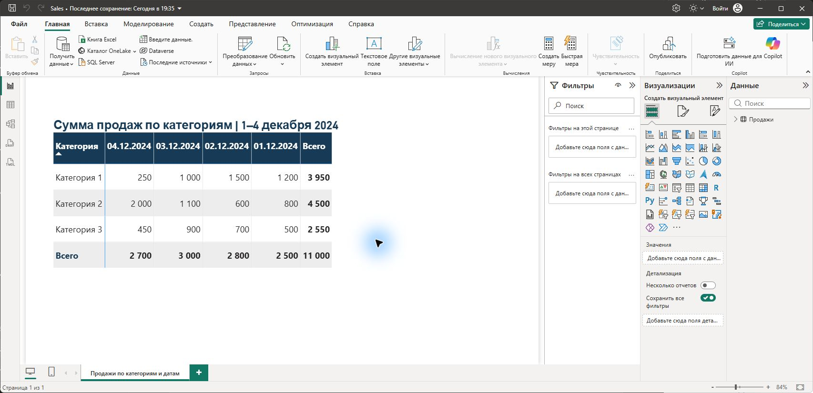

# GA4, Яндекс Метрика и Power BI

Тестовое задание с подробным объяснением действий и проверкой исходных данных.

## Результат

- **Power BI:** готовая матрица продаж за 1–4 декабря 2024 года. Столбцы дат расположены по убыванию. Контрольный итог — **11 000**.
- **Яндекс Метрика:** самостоятельный анализ реального публичного демосчётчика 44147844 за июнь 2024 года, ответы на 11 вопросов, 15 выгрузок JSON и CSV, воспроизводимый Python-код. 6 515 посетителей, 7 505 визитов; доля новых 97,62%, доля посетителей из России 55,21%.
- **GA4:** аудит и восстановление прежнего решения по 18 архивным скриншотам. Исправлены подмены метрик, ошибки знаменателей и чтения таблиц. Неподтверждённые ответы явно обозначены.
- **Конспект:** что сделано, зачем, какие формулы использованы и как дополнить анализ.

## Файлы

| Файл | Назначение |
|---|---|
| [Sales.pbix](Sales.pbix) | Готовый проверенный отчёт Power BI |
| [Matrix.jpg](Matrix.jpg) | Скриншот фактической матрицы в Power BI Desktop |
| [Report.html](Report.html) | Общий отчёт с ответами, конспектом и встроенными скриншотами; скачать и открыть в браузере |
| [solution.zip](solution.zip) | Полный проект: документы Markdown, данные, доказательства, скрипты и редактируемый PBIP |
| [checksums.json](checksums.json) | SHA-256 файлов публикации |

Архив содержит полное дерево папок. Он опубликован вместе с отдельными готовыми результатами, чтобы сохранить структуру Power BI и относительные ссылки между доказательствами и исходными данными. Для переходов из отчёта к отдельным CSV и JSON распакуйте архив и откройте `solution/Отчёт.html`.

## Ограничение исходного периода GA4

16 октября 2026 года проверен вход в Google Merchandise Store, ресурс 213025502. В стандартном отчёте по странам при выборе 01.06.2024–30.06.2024 интерфейс показывает «Нет данных». Причина не установлена; это не доказывает отсутствия посещений в прошлом. Поэтому GA4 представлен как проверка архивного решения с честно обозначенными пробелами. Период задания не подменён свежим.

Данные Метрики относятся к другому сайту, а не к Google Merchandise Store. Сопоставлять их как одну аудиторию нельзя.

## Воспроизведение

Распаковать `solution.zip` и перейти в `solution`. Для скриптов достаточно Python 3.10+ и стандартной библиотеки:

```sh
python scripts/build_reports.py
python scripts/collect_metrica.py
```

Первая команда проверяет сохранённые данные и пересобирает отчёты без Интернета. Вторая повторно получает публичные данные Метрики и требует подключения к Интернету. История запросов и признаки семплирования находятся в `data/metrica/manifest.json`. Для этого решения все 15 запросов успешны, без семплирования; проверены даты, полнота таблиц и арифметика глубины просмотра.

`powerbi/Sales.pbip` — редактируемый проект; `powerbi/source.pq` — встроенная таблица задания. Для сдачи используйте готовый PBIX. Внешние пути к данным ему не нужны.

Исходные документы работодателя, контактный адрес, резюме и другие задания не публикуются. Работа не отправлялась работодателю автоматически.


